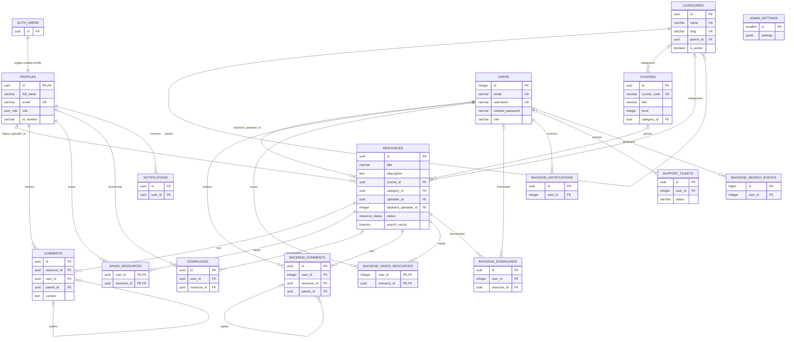
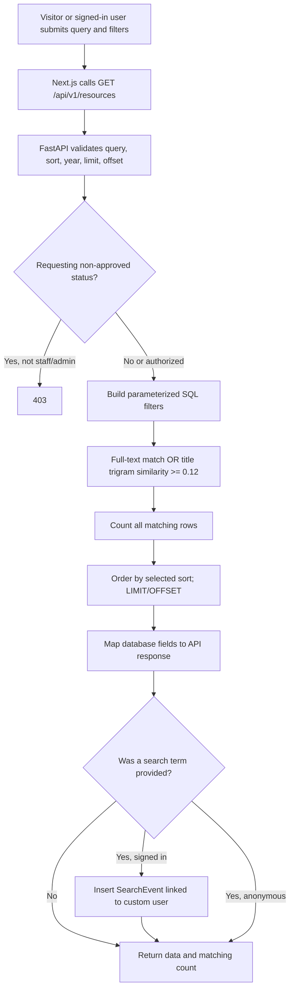
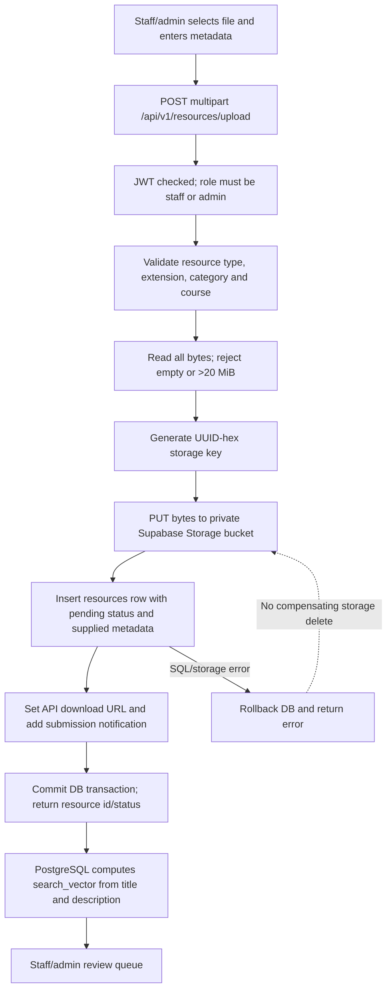
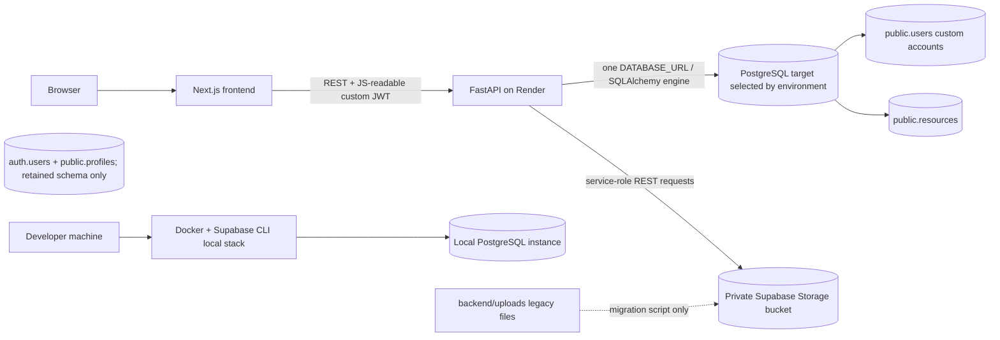
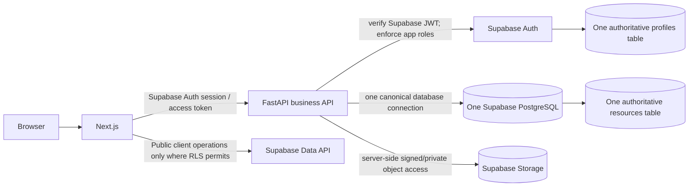

# CSE Hub — Chapter Three Technical Evidence

**Investigation type:** Source review, staging evidence summary, and follow-on source updates
**Evidence date:** 12 November 2026
**Scope:** Checked-out source, Supabase migration files, and explicitly identified staging observations. The initial investigation was read-only; follow-on source changes are listed separately below and have not been applied to a deployed database.

## Evidence labels

- **Verified current implementation** — directly visible in the cited source.
- **Partially implemented** — a related path exists, but does not cover the complete stated feature.
- **Proposed improvement** — recommended target-state work, not a claim about the deployed application.
- **Not implemented** — no implementation was found in the inspected source.
- **Requires runtime verification** — cannot be established from source alone, or depends on the actual database, provider configuration, or deployed build.

Line citations refer to the repository files as reviewed, except where this report notes follow-on source changes. Migration files describe the schema that those scripts create; they do not prove which PostgreSQL instance a particular backend process uses. `DATABASE_URL` is selected at runtime by environment variable, so the Supabase migration target, local Supabase instance, and Render-connected database must be treated as separate until independently verified.

**Follow-on source changes (12 November 2026).** The unused Supabase OAuth endpoint and legacy unmounted `psycopg2` search router were removed; frontend auth no longer depends on the Supabase browser SDK ([auth.py](backend/app/api/v1/auth.py), [package.json](frontend/package.json)). Configuration now uses the shared Pydantic settings object and one SQLAlchemy engine ([session.py:L1-L14](backend/app/db/session.py), [config.py:L1-L1](backend/app/config.py)). Student dashboard metrics now require a student JWT ([dashboard.py:L12-L20](backend/app/api/v1/dashboard.py)); dashboards and resource pages show unavailable/error states rather than fabricated data ([student dashboard](frontend/src/app/student/dashboard/page.tsx), [staff dashboard](frontend/src/app/staff/dashboard/page.tsx), [queries](frontend/src/lib/queries.ts)). The active search event is ORM-mapped to `users` ([search_event.py](backend/app/models/search_event.py), [user.py:L43-L47](backend/app/models/user.py)). An additive migration enforces that a reply's parent comment belongs to the same resource ([migration](supabase/migrations/20261112100000_backend_comment_relationship_integrity.sql)). Supabase identity/profile and legacy engagement tables were deliberately retained because their deployed data and references have not been inventoried. This is a source-state update only; it does not prove a migration has been applied or verify the deployed runtime.

---

## 1. Database design

### 1.1 Database connection architecture

**Verified current implementation.** `backend/app/db/session.py` reads `DATABASE_URL` from the shared Pydantic settings object, fails import if it is empty, creates one SQLAlchemy engine with `pool_pre_ping=True`, and yields/closes ORM sessions. It does not choose a host or assert that the configured server is the Supabase project where migrations were applied. `app.config` re-exports the same settings object. The unused direct-`psycopg2` search router has been removed ([session.py](backend/app/db/session.py), [app/config.py](backend/app/config.py), [core/config.py](backend/app/core/config.py)).

**Requires runtime verification.** The staging setup was separately observed to return the seeded categories and courses from `/api/v1/resources/options`; the user also reported successful signup and login. Those observations support that the running staging API reached a database with those records, but do not establish parity with any local PostgreSQL instance or prove the complete schema is identical. Do not infer the runtime database from the migration files alone.

### 1.2 Actual application table inventory and columns

The checked-in Supabase migrations create or alter the following **16 application tables in `public`**. Standard Supabase `auth` and `storage` schemas also exist outside this application-table inventory. `?` means nullable; `!` means explicitly `NOT NULL` or made non-null by a primary key; `PK`, `FK`, `UQ`, and `DF` identify primary key, foreign key, unique constraint, and default. Columns below are compiled from the initial, backend-workflow, and admin-workflow migrations ([initial_schema.sql](supabase/migrations/20261104165312_initial_schema.sql), [backend_resource_workflows.sql](supabase/migrations/20261106170000_backend_resource_workflows.sql), [admin_support_workflows.sql](supabase/migrations/20261111111500_admin_support_workflows.sql)).

| Table | Columns (type; nullability; key/default where applicable) |
|---|---|
| `profiles` | `id UUID! PK/FK auth.users(id)`; `full_name VARCHAR(255)!`; `email VARCHAR(255)! UQ`; `role user_role! DF student`; `id_number VARCHAR(100)?`; `created_at`, `updated_at TIMESTAMPTZ! DF UTC now`. |
| `categories` | `id UUID! PK DF gen_random_uuid()`; `name VARCHAR(100)! UQ`; `slug VARCHAR(100)! UQ`; `created_at TIMESTAMPTZ! DF UTC now`; later: `description TEXT! DF ''`, `is_active BOOLEAN! DF true`, `parent_id UUID? FK categories(id)`. |
| `courses` | `id UUID! PK DF gen_random_uuid()`; `course_code VARCHAR(20)! UQ`; `title VARCHAR(255)!`; `level INTEGER!`; `category_id UUID? FK categories(id)`; `created_at TIMESTAMPTZ! DF UTC now`; later: `academic_session VARCHAR(20)?`, `is_active BOOLEAN! DF true`. |
| `resources` | `id UUID! PK DF gen_random_uuid()`; `title VARCHAR(255)!`; `description TEXT?`; `file_url TEXT!`; `file_type VARCHAR(50)!`; `file_size BIGINT!`; `course_id UUID? FK courses(id)`; `category_id UUID? FK categories(id)`; `uploader_id UUID? FK profiles(id)`; `programming_language VARCHAR(50)?`; `keywords TEXT[]?`; `status resource_status! DF pending`; `search_vector TSVECTOR? generated/stored`; `created_at`, `updated_at TIMESTAMPTZ! DF UTC now`; later: `resource_type VARCHAR(32)! DF 'other'`, `storage_key TEXT?`, `original_filename VARCHAR(255)?`, `backend_uploader_id INTEGER? FK users(id)`. |
| `comments` | `id UUID! PK DF gen_random_uuid()`; `resource_id UUID! FK resources(id)`; `user_id UUID! FK profiles(id)`; `parent_id UUID? FK comments(id)`; `content TEXT!`; `created_at TIMESTAMPTZ! DF UTC now`. |
| `saved_resources` | `user_id UUID! PK-part/FK profiles(id)`; `resource_id UUID! PK-part/FK resources(id)`; `created_at TIMESTAMPTZ! DF UTC now`. |
| `downloads` | `id UUID! PK DF gen_random_uuid()`; `user_id UUID? FK profiles(id)`; `resource_id UUID? FK resources(id)`; `downloaded_at TIMESTAMPTZ! DF UTC now`. |
| `notifications` | `id UUID! PK DF gen_random_uuid()`; `user_id UUID! FK profiles(id)`; `title VARCHAR(255)!`; `message TEXT!`; `is_read BOOLEAN? DF false`; `notification_type VARCHAR(50)!`; `created_at TIMESTAMPTZ! DF UTC now`. |
| `users` | `id SERIAL! PK`; `full_name VARCHAR(255)!`; `email VARCHAR(255)! UQ`; `username VARCHAR(100)? UQ`; `hashed_password VARCHAR(255)!`; `role VARCHAR(16)! DF 'student'`; `is_active BOOLEAN! DF true`; `is_verified BOOLEAN! DF false`; `created_at TIMESTAMPTZ! DF now`; `updated_at TIMESTAMPTZ?`. |
| `backend_comments` | `id UUID! PK DF gen_random_uuid()`; `resource_id UUID! FK resources(id)`; `user_id INTEGER! FK users(id)`; `parent_id UUID? FK backend_comments(id)`; `content TEXT! CHECK nonblank`; `created_at TIMESTAMPTZ! DF now`. |
| `backend_saved_resources` | `user_id INTEGER! PK-part/FK users(id)`; `resource_id UUID! PK-part/FK resources(id)`; `created_at TIMESTAMPTZ! DF now`. |
| `backend_downloads` | `id UUID! PK DF gen_random_uuid()`; `user_id INTEGER? FK users(id)`; `resource_id UUID! FK resources(id)`; `downloaded_at TIMESTAMPTZ! DF now`. |
| `backend_notifications` | `id UUID! PK DF gen_random_uuid()`; `user_id INTEGER! FK users(id)`; `title VARCHAR(255)!`; `message TEXT!`; `is_read BOOLEAN! DF false`; `notification_type VARCHAR(50)!`; `created_at TIMESTAMPTZ! DF now`. |
| `admin_settings` | `id SMALLINT! PK CHECK id = 1`; `settings JSONB!`; `updated_at TIMESTAMPTZ! DF now`. |
| `support_tickets` | `id UUID! PK DF gen_random_uuid()`; `user_id INTEGER? FK users(id)`; `name VARCHAR(255)!`; `email VARCHAR(320)!`; `subject VARCHAR(255)!`; `category VARCHAR(80)!`; `message TEXT!`; `device_info TEXT?`; `status VARCHAR(20)! DF 'open' CHECK allowed states`; `created_at`, `updated_at TIMESTAMPTZ! DF now`. |
| `backend_search_events` | `id BIGSERIAL! PK`; `user_id INTEGER? FK users(id)`; `created_at TIMESTAMPTZ! DF now`. |

`user_role` is a PostgreSQL enum (`student`, `staff`, `admin`). `resource_status` starts as `pending`, `approved`, `changes_requested`, `archived`, then migration 2 adds `rejected` ([initial_schema.sql:L5-L7](supabase/migrations/20261104165312_initial_schema.sql#L5-L7), [backend_resource_workflows.sql:L15](supabase/migrations/20261106170000_backend_resource_workflows.sql#L15)).

### 1.3 Keys, constraints, indexes, and relationships

- **Primary/foreign keys and deletion behavior — Verified current implementation.** `profiles.id` references `auth.users`; resources have two independent uploader references (`profiles` UUID and backend `users` integer). Category/course links use `SET NULL`/`RESTRICT`; comments, bookmarks, downloads, notifications, and backend equivalents use their declared cascade/set-null actions. Self-referencing category parents and comment reply parents are present ([initial_schema.sql:L10-L103](supabase/migrations/20261104165312_initial_schema.sql#L10-L103), [backend_resource_workflows.sql:L17-L67](supabase/migrations/20261106170000_backend_resource_workflows.sql#L17-L67), [admin_support_workflows.sql:L1-L28](supabase/migrations/20261111111500_admin_support_workflows.sql#L1-L28)).
- **Unique constraints — Verified current implementation.** `profiles.email`, `categories.name`, `categories.slug`, `courses.course_code`, `users.email`, and `users.username` are unique. The two saved-resource tables have composite primary keys, which also prevent duplicate user/resource pairs ([initial_schema.sql:L10-L35](supabase/migrations/20261104165312_initial_schema.sql#L10-L35), [initial_schema.sql:L79-L83](supabase/migrations/20261104165312_initial_schema.sql#L79-L83), [backend_resource_workflows.sql:L2-L7](supabase/migrations/20261106170000_backend_resource_workflows.sql#L2-L7), [backend_resource_workflows.sql:L41-L45](supabase/migrations/20261106170000_backend_resource_workflows.sql#L41-L45)).
- **Check constraints — Verified current implementation.** `backend_comments.content` must be nonblank after trimming; `admin_settings.id` must equal 1; support ticket `status` is limited to `open`, `in_progress`, `resolved`, or `closed` ([backend_resource_workflows.sql:L29-L35](supabase/migrations/20261106170000_backend_resource_workflows.sql#L29-L35), [admin_support_workflows.sql:L10-L28](supabase/migrations/20261111111500_admin_support_workflows.sql#L10-L28)). No database `CHECK` is defined for resource file size/type, user role values in `public.users`, course `level`, or resource status transitions.
- **Explicit migration indexes — Verified current implementation.** `resources_search_idx` is GIN on `search_vector`; `resources_title_trgm_idx` is GIN on `title gin_trgm_ops`; B-tree indexes cover resource `course_id`, `category_id`, `status`, `backend_uploader_id`, and descending `created_at`. Other explicit indexes are `backend_comments(resource_id, created_at)`, `backend_downloads(resource_id, downloaded_at DESC)`, `backend_downloads(user_id, downloaded_at DESC)`, `backend_notifications(user_id, created_at DESC)`, support tickets `created_at DESC`, support `(status, created_at DESC)`, and search events `(user_id, created_at DESC)` ([initial_schema.sql:L62-L66](supabase/migrations/20261104165312_initial_schema.sql#L62-L66), [backend_resource_workflows.sql:L24-L70](supabase/migrations/20261106170000_backend_resource_workflows.sql#L24-L70), [admin_support_workflows.sql:L31-L43](supabase/migrations/20261111111500_admin_support_workflows.sql#L31-L43)). Primary/unique constraints also create PostgreSQL indexes.
- **Reply integrity — Proposed migration; requires runtime verification.** The new additive migration applies a unique `(resource_id, id)` index and a composite self-referencing foreign key to both legacy profile comments and active backend comments. A reply can only point to a comment on the same resource. Existing data is validated during migration; it will fail rather than silently rewrite incompatible rows ([20261112100000_backend_comment_relationship_integrity.sql](supabase/migrations/20261112100000_backend_comment_relationship_integrity.sql)).
- **SQLAlchemy mappings — Verified current implementation.** `User`, `Resource`, and `SearchEvent` are mapped. `User.resources` and `Resource.uploader` map a one-to-many relationship through `Resource.backend_uploader_id`; `User.search_events` and `SearchEvent.user` map the existing `backend_search_events.user_id` FK ([user.py](backend/app/models/user.py), [resource.py](backend/app/models/resource.py), [search_event.py](backend/app/models/search_event.py)). `Resource.uploader_id` separately points to `profiles.id`, but there is no corresponding Profile model or relationship. There are no SQLAlchemy models/relationships for Category, Course, Comment, Bookmark, Download, Notification, SupportTicket, or AdminSettings in the inspected models directory; route code uses SQL text for many of these.
- **RLS — Verified migration state; runtime policy semantics require verification.** The API-only RLS migration enables RLS on all 16 application tables and creates no policies ([enable_api_only_rls.sql:L1-L16](supabase/migrations/20261111190000_enable_api_only_rls.sql#L1-L16)). The prior migration revokes `anon`/`authenticated` access specifically from `admin_settings`, `support_tickets`, and `backend_search_events` ([restrict_admin_support_table_access.sql:L1-L8](supabase/migrations/20261111113000_restrict_admin_support_table_access.sql#L1-L8)). A privileged backend database role is therefore essential to current API operation. Verify the actual runtime DB role and privileges in staging; enabling RLS alone is not evidence that the API role can bypass it or that browser access has the intended policy.

### 1.4 Duplicate identity and resource models

- **Duplicate identity sources — Verified current implementation.** Supabase `auth.users` is referenced by `public.profiles` (UUID identity and student/staff/admin enum). The application's custom `public.users` table has integer IDs, email/password hashes, role text, active/verified flags, and is the model queried by FastAPI registration, login, and authorization. The workflow migration explicitly says it keeps the integer-ID API users table alongside Supabase auth profiles ([initial_schema.sql:L10-L18](supabase/migrations/20261104165312_initial_schema.sql#L10-L18), [backend_resource_workflows.sql:L1-L13](supabase/migrations/20261106170000_backend_resource_workflows.sql#L1-L13), [auth.py:L14-L61](backend/app/api/v1/auth.py#L14-L61)).
- **Profile synchronization — Not implemented between application login stores.** A database trigger creates a `profiles` row when a Supabase `auth.users` record is inserted, using metadata fields ([initial_schema.sql:L105-L123](supabase/migrations/20261104165312_initial_schema.sql#L105-L123)). Custom API registration writes only to `public.users` and does not create Supabase Auth identities or synchronize `profiles`. No canonical cross-ID mapping exists.
- **Duplicate resource uploader model — Verified current implementation.** `public.resources.uploader_id` refers to `profiles.id`, while `backend_uploader_id` refers to `users.id`. Active upload and related-resource queries use `backend_uploader_id`; the resource ORM relationship also uses it. The profile-based uploader field remains in the initial schema/model but is not the active uploader association in the inspected upload route ([initial_schema.sql:L39-L60](supabase/migrations/20261104165312_initial_schema.sql#L39-L60), [backend_resource_workflows.sql:L17-L22](supabase/migrations/20261106170000_backend_resource_workflows.sql#L17-L22), [resources.py:L648-L744](backend/app/api/v1/resources.py#L648-L744)).
- **Duplicate engagement tables — Verified current implementation.** Profile UUID tables (`comments`, `saved_resources`, `downloads`, `notifications`) coexist with API integer-user tables (`backend_comments`, `backend_saved_resources`, `backend_downloads`, `backend_notifications`). Active resource and notification routes use the `backend_*` forms. Data parity with the profile-based tables has not been demonstrated.

### 1.5 ER diagram (migrated application schema)

**Verified current implementation.** This diagram shows the declared application foreign keys. Supabase system tables are shown only where directly referenced; it is not a claim that the backend uses Supabase Auth identities for its custom users.



---

## 2. Search algorithm

### 2.1 Active search implementation

**Verified current implementation.** The mounted resource-list endpoint uses `_resource_query` in `backend/app/api/v1/resources.py`. It starts with an optional status condition, adds resource type, course code, category slug, file type, language, and year filters, then applies this search predicate when `search` is nonempty:

```sql
(r.search_vector @@ plainto_tsquery('english', :search)
 OR similarity(r.title, :search) >= 0.12)
```

The count query uses the same joins and predicates. Results use `LIMIT :limit OFFSET :offset`. Source: [resources.py:L145-L222](backend/app/api/v1/resources.py#L145-L222).

**Searchable fields.** The stored generated vector combines title at weight `A` and description at weight `B`; it uses English text search and `coalesce(..., '')`. The fuzzy predicate compares only `r.title`. Neither keywords nor category/course text is added to the vector ([initial_schema.sql:L49-L60](supabase/migrations/20261104165312_initial_schema.sql#L49-L60)).

**Exact ranking/order.**

- `sort_by=relevance` with a query sorts lexicographically by `ts_rank(search_vector, plainto_tsquery('english', search)) DESC`, then `similarity(title, search) DESC`, then `created_at DESC`.
- `sort_by=relevance` without a query sorts by `created_at DESC`.
- Other supported orderings are `newest`, `oldest`, `title_asc`, `title_desc`, and `downloads`; download sorting counts `backend_downloads` per resource and breaks ties by newest.
- No application-specified numeric combination of ranking signals exists. The implementation is a lexicographic ordering, not a weighted sum. There is no `ts_rank_cd` use in the inspected project. `ts_rank` has no explicit custom weight array at the call site; the vector itself labels title `A` and description `B`. No BM25, TF-IDF, semantic, embedding, or learning-to-rank code was found.
- Match threshold `0.12` applies only to the trigram `similarity()` branch; full-text matches have no explicit score threshold.

Sources: [resources.py:L180-L212](backend/app/api/v1/resources.py#L180-L212), [initial_schema.sql:L53-L60](supabase/migrations/20261104165312_initial_schema.sql#L53-L60).

**Indexes and extension.** The initial migration enables `pg_trgm`, creates a GIN index on the generated vector, and a GIN trigram operator-class index on title ([initial_schema.sql:L1-L3](supabase/migrations/20261104165312_initial_schema.sql#L1-L3), [initial_schema.sql:L62-L66](supabase/migrations/20261104165312_initial_schema.sql#L62-L66)). `similarity()` is used by the active endpoint. Whether PostgreSQL chooses the trigram index for the `similarity(title, query) >= 0.12` expression requires `EXPLAIN` against the actual staging database; source code alone cannot establish the query plan.

No application-defined SQL search function or custom text-search configuration was found in the inspected migrations. Search uses PostgreSQL built-ins in route SQL; the initial migration's `handle_new_user()` is a profile trigger, not a search function ([initial_schema.sql:L105-L123](supabase/migrations/20261104165312_initial_schema.sql#L105-L123)).

### 2.2 Pagination, filtering, and validation

`GET /api/v1/resources` allows search length 1–200, `year` 1900–2200, limit 1–100 (default 50), nonnegative offset (default 0), and a fixed sort choice. `course_code`, file type, and programming language use case-insensitive substring comparisons; category slug is exact; year filters `EXTRACT(YEAR FROM created_at)`. Public/ordinary-user results default to approved resources; staff/admin may request other supported statuses ([resources.py:L245-L304](backend/app/api/v1/resources.py#L245-L304)).

### 2.3 Legacy search router

The stale, unmounted `backend/app/routers/search.py` implementation was removed. The active search implementation remains `GET /api/v1/resources` in `backend/app/api/v1/resources.py`; the frontend calls this endpoint. There is no second live search implementation.

### 2.4 Search workflow



Source: [resources.py:L145-L222](backend/app/api/v1/resources.py#L145-L222), [resources.py:L245-L304](backend/app/api/v1/resources.py#L245-L304), [search/page.tsx:L140-L170](frontend/src/app/search/page.tsx#L140-L170).

---

## 3. Document upload and processing

### 3.1 Verified upload behavior

- **Authorization:** only `staff` and `admin` may upload, via `RoleChecker(["staff", "admin"])` ([resources.py:L76](backend/app/api/v1/resources.py#L76), [resources.py:L648-L661](backend/app/api/v1/resources.py#L648-L661)).
- **Allowed filename extensions:** `.pdf`, `.doc`, `.docx`, `.ppt`, `.pptx`, `.txt`, `.md`, `.py`, `.js`, `.jsx`, `.ts`, `.tsx`, `.java`, `.c`, `.h`, `.cpp`, `.sql`, `.html`, `.css`, `.json` ([resources.py:L37-L60](backend/app/api/v1/resources.py#L37-L60)). The allow-list assigns generic `document`, `text`, or `code` metadata and default programming-language labels for source types.
- **Maximum size:** 20 MiB in the API; empty uploads are rejected. The endpoint reads the entire file into memory before measuring its size, so this is not a streaming limit ([resources.py:L37](backend/app/api/v1/resources.py#L37), [resources.py:L696-L703](backend/app/api/v1/resources.py#L696-L703)).
- **File validation:** basename is extracted from the supplied filename and extension is lowercased before allow-list lookup. Category UUID/existence and course-code/existence are checked. Title/resource type and keyword count/length have validation and normalization ([resources.py:L648-L700](backend/app/api/v1/resources.py#L648-L700)).
- **MIME/content validation:** **Not implemented.** The upload path does not inspect `UploadFile.content_type`, file signatures/magic bytes, or parse file contents. Download response MIME is guessed from filename only ([resources.py:L648-L710](backend/app/api/v1/resources.py#L648-L710), [resources.py:L948-L980](backend/app/api/v1/resources.py#L948-L980)).
- **Naming:** storage key is a random UUID hex string plus the validated extension. Original basename is kept separately, truncated to 255 characters ([resources.py:L691-L720](backend/app/api/v1/resources.py#L691-L720)).
- **Metadata:** title, description, resource type, course, category, programming language, and comma-separated keywords are provided by the form; file size/type and original filename are recorded by API code. No PDF/Office metadata parser or text extractor is invoked during upload ([resources.py:L648-L744](backend/app/api/v1/resources.py#L648-L744)).
- **Storage:** active upload uses `save_uploaded_bytes` to call the Supabase Storage REST object endpoint using a server-only service role key, `x-upsert: true`, and an octet-stream body. The migration configures `cse-hub-files` as a private bucket with a 50 MiB bucket limit; the API limit is tighter at 20 MiB ([storage.py:L9-L49](backend/app/services/storage.py#L9-L49), [20261109110000_cse_hub_storage_bucket.sql:L1-L5](supabase/migrations/20261109110000_cse_hub_storage_bucket.sql#L1-L5)).
- **Local filesystem:** the active resource endpoint does not save to a local directory. A migration utility reads old files from `backend/uploads` (or `CSE_HUB_UPLOAD_DIR`) and copies them into Supabase Storage; it is a legacy migration path, not the current upload storage implementation ([migrate_local_uploads_to_supabase.py:L1-L52](backend/scripts/migrate_local_uploads_to_supabase.py#L1-L52)).
- **Search indexing:** PostgreSQL's generated vector indexes title and description automatically when the resource row is written. Uploaded file bytes are not extracted/indexed. `backend/app/services/text_extractor.py` is zero bytes in the checked-out tree, so text extraction is **not implemented**.
- **Duplicate detection:** **Not implemented.** No content hash, filename uniqueness, or duplicate query was found.
- **Access:** private storage bucket is accessed server-side through the privileged service key. Resource bytes are served by API routes; approved resources are visible/downloadable without login, while non-approved resources are limited by `_visible_resource` to staff/admin or the owning backend user. Authenticated downloads are recorded; anonymous downloads are not ([resources.py:L127-L142](backend/app/api/v1/resources.py#L127-L142), [resources.py:L948-L980](backend/app/api/v1/resources.py#L948-L980)).
- **Error behavior:** unsupported extension 415; invalid metadata/category/course 422; empty 422; over-limit 413; storage configuration missing 503; storage HTTP/network failures 502; database/filesystem upload failures logged and returned as generic 500. File is closed in `finally`. The storage write precedes database commit; a later SQL failure rolls back database changes but no storage delete/compensation is present, so an orphaned stored object is possible ([resources.py:L662-L744](backend/app/api/v1/resources.py#L662-L744), [storage.py:L28-L61](backend/app/services/storage.py#L28-L61)).
- **Inline preview:** text/code preview is limited to stored `text` and `code` resource types; inline document preview only accepts a `.pdf` original filename. Other uploaded document formats can be downloaded but not inline-previewed ([resources.py:L796-L849](backend/app/api/v1/resources.py#L796-L849)).

### 3.2 Upload and processing workflow



Sources: [resources.py:L648-L744](backend/app/api/v1/resources.py#L648-L744), [initial_schema.sql:L53-L60](supabase/migrations/20261104165312_initial_schema.sql#L53-L60), [storage.py:L28-L61](backend/app/services/storage.py#L28-L61).

---

## 4. Authentication and authorization

### 4.1 Verified current implementation

1. **Email/password registration.** Frontend posts full name, email, derived username, password, and student role to FastAPI. The API checks email/username collisions, bcrypt-hashes the password, inserts a row into `public.users`, and returns a user response. It does not send/verify email ownership ([register/page.tsx](frontend/src/app/register/page.tsx), [auth.py](backend/app/api/v1/auth.py)).
2. **Email/password login.** FastAPI finds the `public.users` row by email, verifies its bcrypt hash, rejects inactive users, then creates a JWT containing `exp`, `sub` (custom integer user ID string), and `role` ([auth.py](backend/app/api/v1/auth.py), [security.py](backend/app/core/security.py)).
3. **OAuth login.** **Not implemented.** The unused FastAPI OAuth endpoint, Supabase browser client, and placeholder callback page were removed. Supabase remains in use for PostgreSQL and private object storage, not app authentication.
4. **JWT verification.** `get_current_user` decodes JWT using configured secret/algorithm, converts `sub` to integer, retrieves the current database user, and rejects missing/inactive users. The role claim is not the authorization source; `RoleChecker` checks the database user's role ([deps.py](backend/app/api/deps.py)).
5. **Frontend cookie handling.** Login stores token, role, name, username, and email using JavaScript-accessible `js-cookie`; “remember me” gives cookies a seven-day expiry, while otherwise they are session cookies. The backend default JWT lifetime is eight days. No HttpOnly/Secure/SameSite options are set in this call site ([login/page.tsx:L21-L54](frontend/src/app/login/page.tsx#L21-L54), [core/config.py:L9-L18](backend/app/core/config.py#L9-L18)).
6. **API token attachment.** Axios reads the `token` cookie and adds `Authorization: Bearer ...` to API calls ([api.ts:L1-L22](frontend/src/lib/api.ts#L1-L22)).
7. **Frontend route protection.** Next middleware checks token presence and the client cookie `role` for `/student`, `/staff`, `/admin`; it does not cryptographically verify the token. Backend dependencies remain the authoritative API access check ([middleware.ts:L1-L39](frontend/src/middleware.ts#L1-L39), [deps.py:L20-L70](backend/app/api/deps.py#L20-L70)).
8. **Backend role restrictions.** Resource upload/review/metadata updates require staff/admin; student, staff, and admin dashboards require their respective roles; admin routes require admin. Public resource browse/preview/download and support ticket submission allow optional authentication; user-scoped bookmarks/comments/notifications require authentication ([resources.py](backend/app/api/v1/resources.py), [dashboard.py](backend/app/api/v1/dashboard.py), [admin.py](backend/app/api/v1/admin.py)).
9. **Profile synchronization.** Supabase trigger still writes `profiles` from Supabase Auth metadata, but the application login flow now uses only custom `public.users`. No ongoing synchronization between `profiles` and `users`, or canonical identifier mapping, exists ([initial_schema.sql:L105-L123](supabase/migrations/20261104165312_initial_schema.sql#L105-L123), [auth.py](backend/app/api/v1/auth.py)).

### 4.2 Inconsistencies and security implications

- **Partially implemented.** Two identity stores and two resource-uploader IDs exist; account creation and API authorization use custom `users`, while Supabase has `auth.users`/`profiles`.
- **Not implemented.** OAuth login is no longer exposed by the application; existing Supabase Auth/profile records remain in the database pending a verified data migration.
- **Requires security review.** Auth cookies are accessible to JavaScript; stolen tokens may be exposed by script injection. Middleware trusts a client-controlled role cookie for page navigation, although protected API calls still validate the JWT and load role from the database.
- **Potential privilege concern requiring runtime/security verification.** The Supabase profile trigger casts `raw_user_meta_data.role` into `user_role` and runs `SECURITY DEFINER` ([initial_schema.sql:L105-L123](supabase/migrations/20261104165312_initial_schema.sql#L105-L123)). If client-controlled Supabase Auth signup reaches this trigger, role assignment from user metadata must be checked and restricted. This profile role does not automatically grant the separate custom API user role, but is still a sensitive profile integrity concern.
- **Not implemented.** Email verification for custom accounts, password reset flow, refresh/revocation/session-management flow, and OAuth login.

### 4.3 Authentication sequence

```mermaid
sequenceDiagram
  actor U as User
  participant F as Next.js browser
  participant A as FastAPI
  participant DB as PostgreSQL public.users

  U->>F: Submit email and password
  F->>A: POST /api/v1/auth/login
  A->>DB: Find user by email
  DB-->>A: User row and password hash
  A->>A: Verify bcrypt; create exp/sub/role JWT
  A-->>F: access_token, role, identity fields
  F->>F: Store JS-readable cookies; role-based redirect
  F->>A: Protected API request + Bearer JWT
  A->>A: Verify signature/expiry; parse sub
  A->>DB: Reload user and active state
  DB-->>A: Current role and user
  A->>A: Apply route RoleChecker
  A-->>F: Authorized response or 401/403

```

Sources: [login/page.tsx](frontend/src/app/login/page.tsx), [auth.py](backend/app/api/v1/auth.py), [security.py](backend/app/core/security.py), [deps.py](backend/app/api/deps.py).

---

## 5. Resource management workflow

| Feature | Current implementation and evidence |
|---|---|
| Create/upload | **Verified current implementation.** Staff/admin upload multipart file and supplied metadata; object is saved to Supabase Storage; resource row starts `pending`; a backend notification is inserted ([resources.py:L648-L744](backend/app/api/v1/resources.py#L648-L744)). |
| Read/list/search | **Verified current implementation.** Public list defaults to approved; staff/admin can request other statuses. Specific resource detail uses `_visible_resource`; categories/courses/years options are DB-backed ([resources.py:L127-L142](backend/app/api/v1/resources.py#L127-L142), [resources.py:L245-L356](backend/app/api/v1/resources.py#L245-L356), [resources.py:L983-L1005](backend/app/api/v1/resources.py#L983-L1005)). |
| Edit metadata | **Verified current implementation, staff/admin only.** `PATCH /resources/{id}` updates title, description, type, course, category, keywords; it does not replace file bytes ([resources.py:L575-L646](backend/app/api/v1/resources.py#L575-L646)). |
| Delete resource | **Not implemented.** No `DELETE /resources/{id}` route was found. The frontend `DELETE /resources/{id}/bookmark` only removes a bookmark, not the resource ([resources.py:L907-L946](backend/app/api/v1/resources.py#L907-L946), [my-resources/page.tsx:L38](frontend/src/app/my-resources/page.tsx#L38)). |
| Review/approval | **Verified current implementation.** Staff/admin can approve, request changes, or reject a resource only while its current state is pending. A notification is written to the submitting custom user if present. `notes` is used in the notification text; no review-history table or reviewer audit record is written ([resources.py:L498-L573](backend/app/api/v1/resources.py#L498-L573)). |
| Comments/replies | **Verified current implementation.** Authenticated users can post comments; `parent_id` must identify a comment on the same resource. Reads are chronological and include parent IDs. A resource owner notification is written for comments by a different user ([resources.py:L763-L794](backend/app/api/v1/resources.py#L763-L794), [resources.py:L851-L905](backend/app/api/v1/resources.py#L851-L905)). |
| Bookmarks | **Verified current implementation.** Authenticated `PUT` uses `ON CONFLICT DO NOTHING`; `DELETE` removes the current user/resource pair. My-resources joins saved records to approved resources ([resources.py:L404-L463](backend/app/api/v1/resources.py#L404-L463), [resources.py:L907-L946](backend/app/api/v1/resources.py#L907-L946)). |
| Downloads | **Verified current implementation.** API retrieves private bytes and returns attachment; authenticated downloads insert `backend_downloads`, while anonymous approved downloads are allowed and not counted ([resources.py:L948-L980](backend/app/api/v1/resources.py#L948-L980)). |
| Notifications | **Verified current implementation.** Submission, review, and resource comment events create `backend_notifications`. Authenticated user can list last 100 and mark one/all read ([resources.py:L225-L243](backend/app/api/v1/resources.py#L225-L243), [notifications.py:L21-L99](backend/app/api/v1/notifications.py#L21-L99)). Email/push delivery is **not implemented**. |
| Archive resource | **Partially implemented.** `archived` is a valid resource status and can be filtered, but no resource archive/unarchive route was found. Admin course archive is implemented separately ([initial_schema.sql:L6-L7](supabase/migrations/20261104165312_initial_schema.sql#L6-L7), [admin.py:L306-L321](backend/app/api/v1/admin.py#L306-L321)). |
| Admin settings/support | **Verified persistence, partially enforced.** Admin settings JSON is stored; support tickets persist and admin can change status. Delivery emails, rate limits/CAPTCHA, attachment storage, and enforcement of all settings were not found ([admin.py:L376-L415](backend/app/api/v1/admin.py#L376-L415), [admin.py:L417-L490](backend/app/api/v1/admin.py#L417-L490)). |

### Resource approval workflow

```mermaid
stateDiagram-v2
  [*] --> Pending: staff/admin uploads
  Pending --> Approved: staff/admin approves
  Pending --> ChangesRequested: staff/admin requests changes
  Pending --> Rejected: staff/admin rejects
  Approved --> [*]: visible in public search and resource pages
  ChangesRequested --> [*]: user notification; no resubmission transition found
  Rejected --> [*]: user notification; no resubmission transition found
  note right of Pending
    Review update is conditional on status still being pending.
    No reviewer/audit-history table is written.
  end note
```



Sources: [resources.py:L498-L573](backend/app/api/v1/resources.py#L498-L573), [resources.py:L245-L304](backend/app/api/v1/resources.py#L245-L304).

---

## 6. API inventory

All mounted endpoint groups below are included under `/api/v1` by the main application. Most endpoints return untyped dictionaries/lists rather than declared Pydantic response models; only auth routes shown with `response_model` declare them explicitly ([main.py:L35-L36](backend/app/main.py#L35-L36), [__init__.py:L1-L15](backend/app/api/v1/__init__.py#L1-L15)).

`Public` means no token required; `optional` means token is used if supplied. `Authenticated` requires a valid active custom user. Database operations refer to `public` app tables unless specified.

### Root, authentication, and dashboards

| Method and path | Request → response | Auth / role | Main database behavior | Source |
|---|---|---|---|---|
| `GET /health` | none → health JSON | Public | none | [main.py:L26-L29](backend/app/main.py#L26-L29) |
| `GET /` | none → message JSON | Public | none | [main.py:L31-L33](backend/app/main.py#L31-L33) |
| `POST /api/v1/auth/register` | `UserRegister` → `UserResponse`, 201 | Public | Check email/username; insert `users` | [auth.py](backend/app/api/v1/auth.py), [user.py](backend/app/schemas/user.py) |
| `POST /api/v1/auth/login` | `UserLogin` → `Token` | Public | Select `users`; verify password | [auth.py](backend/app/api/v1/auth.py), [user.py](backend/app/schemas/user.py) |
| `GET /api/v1/auth/me` | none → `UserResponse` | Authenticated | Load current `users` row in dependency | [auth.py](backend/app/api/v1/auth.py), [deps.py](backend/app/api/deps.py) |
| `GET /api/v1/dashboard/student` | none → metrics/recent resources | Student | Counts approved resources, user downloads/bookmarks/search events; latest five resources | [dashboard.py](backend/app/api/v1/dashboard.py) |
| `GET /api/v1/dashboard/staff` | none → metrics/submissions | Staff/admin | Resource, pending, downloads, users counts; latest submissions | [dashboard.py:L78-L126](backend/app/api/v1/dashboard.py#L78-L126) |
| `GET /api/v1/dashboard/admin` | none → metrics/role distribution/growth | Admin | Counts and grouped user/resource queries | [dashboard.py:L129-L194](backend/app/api/v1/dashboard.py#L129-L194) |

### Resources

| Method and path | Request → response | Auth / role | Main database behavior | Source |
|---|---|---|---|---|
| `GET /api/v1/resources` | Query: type, status, course, category, search, file type, language, year, sort, limit, offset → `{data,count}` | Optional; non-approved status staff/admin only | Count + filtered resource rows; logs search event | [resources.py:L245-L304](backend/app/api/v1/resources.py#L245-L304) |
| `GET /api/v1/resources/past-questions` | none → resource list | Public | Approved past-question resources | [resources.py:L306-L310](backend/app/api/v1/resources.py#L306-L310) |
| `GET /api/v1/resources/projects` | none → project list with display fields | Public | Approved project resources | [resources.py:L312-L324](backend/app/api/v1/resources.py#L312-L324) |
| `GET /api/v1/resources/options` | none → categories, courses, approved years | Public | Select categories/courses/years | [resources.py:L326-L356](backend/app/api/v1/resources.py#L326-L356) |
| `GET /api/v1/resources/stats` | none → totals | Public | Count approved resources, users, courses | [resources.py:L358-L376](backend/app/api/v1/resources.py#L358-L376) |
| `GET /api/v1/resources/code-preview` | none → latest approved code sample | Public | Select resource; read bytes from Storage if key exists | [resources.py:L378-L402](backend/app/api/v1/resources.py#L378-L402) |
| `GET /api/v1/resources/my-resources` | Query `tab=saved|downloaded|uploads|readingList` → list | Authenticated | Join current user to saved/download/upload rows | [resources.py:L404-L463](backend/app/api/v1/resources.py#L404-L463) |
| `GET /api/v1/resources/submissions` | Query status → submission list | Staff/admin | Filter resources by review status | [resources.py:L465-L495](backend/app/api/v1/resources.py#L465-L495) |
| `POST /api/v1/resources/approve/{resource_id}` | path ID → status | Staff/admin | Conditional pending→approved; notification | [resources.py:L556-L563](backend/app/api/v1/resources.py#L556-L563) |
| `POST /api/v1/resources/{resource_id}/review` | `ReviewDecision(action, notes)` → status | Staff/admin | Conditional pending→approved/changes_requested/rejected; notification | [resources.py:L565-L573](backend/app/api/v1/resources.py#L565-L573), [resources.py:L498-L553](backend/app/api/v1/resources.py#L498-L553) |
| `PATCH /api/v1/resources/{resource_id}` | `ResourceMetadataUpdate` → resource metadata | Staff/admin | Update title/description/type/course/category/keywords | [resources.py:L575-L646](backend/app/api/v1/resources.py#L575-L646) |
| `POST /api/v1/resources/upload` | Multipart file + metadata → ID/status/URL, 201 | Staff/admin | Store object; insert resource and notification | [resources.py:L648-L744](backend/app/api/v1/resources.py#L648-L744) |
| `GET /api/v1/resources/{resource_id}/comments` | path ID → chronological comments | Optional | Select `backend_comments` and `users` | [resources.py:L763-L794](backend/app/api/v1/resources.py#L763-L794) |
| `GET /api/v1/resources/{resource_id}/preview` | path ID → code/text content | Optional | Check visibility; read private Storage bytes | [resources.py:L796-L822](backend/app/api/v1/resources.py#L796-L822) |
| `GET /api/v1/resources/{resource_id}/file-preview` | path ID → inline PDF stream | Optional | Check visibility; read private Storage bytes | [resources.py:L825-L849](backend/app/api/v1/resources.py#L825-L849) |
| `POST /api/v1/resources/{resource_id}/comments` | `CommentCreate(content,parent_id)` → comment, 201 | Authenticated | Insert `backend_comments`; maybe notify uploader | [resources.py:L851-L905](backend/app/api/v1/resources.py#L851-L905) |
| `PUT /api/v1/resources/{resource_id}/bookmark` | path ID → `{saved:true}` | Authenticated | Idempotent insert `backend_saved_resources` | [resources.py:L907-L927](backend/app/api/v1/resources.py#L907-L927) |
| `DELETE /api/v1/resources/{resource_id}/bookmark` | path ID → `{saved:false}` | Authenticated | Delete current user's saved row | [resources.py:L929-L946](backend/app/api/v1/resources.py#L929-L946) |
| `GET /api/v1/resources/{resource_id}/download` | path ID → file attachment | Optional | Read Storage; record only authenticated download | [resources.py:L948-L980](backend/app/api/v1/resources.py#L948-L980) |
| `GET /api/v1/resources/{resource_id}` | path ID → resource details + `is_saved` | Optional | Read resource and optional saved status | [resources.py:L983-L1005](backend/app/api/v1/resources.py#L983-L1005) |

### Admin, support, and notifications

| Method and path | Request → response | Auth / role | Main database behavior | Source |
|---|---|---|---|---|
| `GET /api/v1/admin/users` | none → user list | Admin | Select users + resource counts | [admin.py:L68-L99](backend/app/api/v1/admin.py#L68-L99) |
| `PATCH /api/v1/admin/users/{user_id}` | `UserUpdate(role,is_active)` → updated role/state | Admin | Update custom user; prevent self-demotion/deactivation | [admin.py:L101-L122](backend/app/api/v1/admin.py#L101-L122) |
| `GET /api/v1/admin/categories` | none → categories and courses | Admin | Select category/course counts and states | [admin.py:L124-L183](backend/app/api/v1/admin.py#L124-L183) |
| `POST /api/v1/admin/categories` | `CategoryCreate` → ID/name, 201 | Admin | Insert category | [admin.py:L185-L208](backend/app/api/v1/admin.py#L185-L208) |
| `PATCH /api/v1/admin/categories/{category_id}` | `CategoryUpdate` → updated | Admin | Update category fields/status | [admin.py:L210-L241](backend/app/api/v1/admin.py#L210-L241) |
| `POST /api/v1/admin/courses` | `CourseCreate` → ID, 201 | Admin | Check active category; insert course | [admin.py:L243-L273](backend/app/api/v1/admin.py#L243-L273) |
| `PATCH /api/v1/admin/courses/{course_id}` | `CourseCreate` → updated | Admin | Update course fields | [admin.py:L275-L304](backend/app/api/v1/admin.py#L275-L304) |
| `PATCH /api/v1/admin/courses/{course_id}/archive` | Query archived boolean → state | Admin | Set `courses.is_active` | [admin.py:L306-L321](backend/app/api/v1/admin.py#L306-L321) |
| `GET /api/v1/admin/analytics` | none → counts/popular resources | Admin | Count users/resources/downloads; aggregate downloads | [admin.py:L323-L374](backend/app/api/v1/admin.py#L323-L374) |
| `GET /api/v1/admin/settings` | none → JSON settings or null | Admin | Select `admin_settings` singleton | [admin.py:L376-L390](backend/app/api/v1/admin.py#L376-L390) |
| `PUT /api/v1/admin/settings` | `SettingsUpdate(settings: dict)` → settings/time | Admin | Upsert singleton JSONB | [admin.py:L392-L415](backend/app/api/v1/admin.py#L392-L415) |
| `POST /api/v1/support/tickets` | `SupportTicketCreate` → ID/status/time, 201 | Optional auth; public accepted | Insert support ticket; authenticated identity overrides supplied identity | [admin.py:L32-L54](backend/app/api/v1/admin.py#L32-L54), [admin.py:L417-L448](backend/app/api/v1/admin.py#L417-L448) |
| `GET /api/v1/admin/support-tickets` | Optional status filter → up to 200 tickets | Admin | Select support tickets | [admin.py:L450-L476](backend/app/api/v1/admin.py#L450-L476) |
| `PATCH /api/v1/admin/support-tickets/{ticket_id}` | Query status → new status | Admin | Update ticket status | [admin.py:L478-L490](backend/app/api/v1/admin.py#L478-L490) |
| `GET /api/v1/notifications` | none → current user's latest 100 | Authenticated | Select `backend_notifications` | [notifications.py:L21-L54](backend/app/api/v1/notifications.py#L21-L54) |
| `PATCH /api/v1/notifications/{notification_id}/read` | path ID → read state | Authenticated | Update only current user's notification | [notifications.py:L57-L80](backend/app/api/v1/notifications.py#L57-L80) |
| `POST /api/v1/notifications/read-all` | none → updated count | Authenticated | Mark current user's unread notifications read | [notifications.py:L83-L99](backend/app/api/v1/notifications.py#L83-L99) |

### Frontend/API comparison

**Verified current implementation.** The frontend uses the mounted route families for login/register, dashboards, resource search/options/detail/preview/download/comments/bookmarks, admin users/categories/courses/settings/analytics, support tickets, and notifications. Examples are [queries.ts:L18-L395](frontend/src/lib/queries.ts#L18-L395), [search/page.tsx:L140-L170](frontend/src/app/search/page.tsx#L140-L170), [resource detail page:L92-L175](frontend/src/app/resources/[id]/page.tsx#L92-L175), and [staff upload page:L42-L72](frontend/src/app/staff/upload/page.tsx#L42-L72).

- **Mismatch/unused endpoint:** the legacy `/api/v1/search/` router is not mounted and has no frontend call. The actual frontend search uses `GET /api/v1/resources`.
- **Missing capability:** no resource-delete endpoint/UI flow was found; bookmark deletion is a different endpoint.
- **Partially implemented workflow:** staff submission response maps `submitterRole` to the constant `"staff"` and `submitterEmail` to `""`; those values are not looked up from the submitter's user record ([resources.py:L465-L495](backend/app/api/v1/resources.py#L465-L495)).
- Other inspected frontend calls match mounted methods/paths. Runtime success for every route has not been demonstrated; code-level path comparison is not an end-to-end test.

---

## 7. Current architecture versus recommended architecture

### A. Current implemented architecture

**Verified current implementation.** Next.js frontend calls FastAPI via a configurable `NEXT_PUBLIC_API_URL`; the API uses custom JWT auth and one SQLAlchemy engine configured from `DATABASE_URL`. API runtime storage uses Supabase Storage REST with service-role authorization. Supabase Auth/profile tables remain in the database schema, but no app OAuth endpoint or browser SDK is wired into the application. The schema also retains separate custom integer-ID users/resources associations. Local development uses a Supabase CLI-managed stack, which requires Docker Desktop; this is separate from Render-hosted runtime ([api.ts](frontend/src/lib/api.ts), [session.py](backend/app/db/session.py), [storage.py](backend/app/services/storage.py), [PROJECT_GUIDE.md](docs/PROJECT_GUIDE.md)).

**Local filesystem qualification.** An existing `backend/uploads` directory is referenced by a one-off migration utility for moving legacy files. Current upload/read routes call Supabase Storage, not a local filesystem adapter. Therefore the source supports a legacy local-file migration path, not a verified active local-file storage fallback ([migrate_local_uploads_to_supabase.py:L14-L45](backend/scripts/migrate_local_uploads_to_supabase.py#L14-L45), [resources.py:L696-L710](backend/app/api/v1/resources.py#L696-L710)).

**Requires runtime verification.** The exact host behind local `DATABASE_URL` is not established by this source audit. The successful staging category/course API response and user-reported signup/login are staging evidence only; do not treat them as proof that local Supabase and hosted Supabase are the same instance.



### B. Recommended standardized architecture

**Proposed improvement — not current implementation.**



**Migration required to reach target — Proposed improvement.**

1. Inventory local and hosted databases independently; select one canonical Supabase project and take verified backups before any destructive consolidation.
2. Define stable identity mapping from custom `users.id` to Supabase `auth.users.id`; reconcile duplicate emails and role/status conflicts. Supabase Auth password hashes generally cannot simply be assumed portable from the current bcrypt field; plan password reset/re-enrollment or a carefully tested transitional login.
3. Migrate custom `users` metadata to one profile table, define trusted server-side role assignment, and stop accepting roles from client-controlled metadata. Add a controlled bootstrap procedure for initial admins.
4. Map all existing integer user references (`backend_uploader_id`, backend comments/bookmarks/downloads/notifications/search events/support tickets) to the canonical UUID. Backfill, verify row counts and orphan checks, then migrate foreign keys and application queries.
5. Choose one `resources` uploader key and retire the duplicate `uploader_id`/`backend_uploader_id` model only after reference counts and data reconciliation. Consolidate profile-based and `backend_*` engagement tables with duplicate checks and preservation of IDs/timestamps.
6. Migrate any remaining local files using the existing script only after verifying keys, checksums, and database-to-object references. Preserve the private bucket policy and avoid exposing service-role credentials to the browser.
7. Replace custom login/provisioning with Supabase Auth access-token verification; update the callback, cookie/session strategy, logout/refresh, and API dependencies. Keep FastAPI as the business-logic and authorization boundary.
8. Add table-specific RLS policies and least-privilege roles; test browser roles and backend role separately. Apply schema migrations to a fresh staging copy, then test identity, ownership, approval, storage access, rollback, and backup restoration before cutover.
9. Remove duplicate routes/models only after staged traffic and data parity verification; keep a reversible migration plan and monitoring.

---

## 8. Chapter Three evidence package

### 8.1 Functional requirements matrix

These are **evidence-derived system functions**, not a claim that the original requirements document defines them. Status describes source-code implementation.

| ID | Functional requirement | Status | Evidence / limitation |
|---|---|---|---|
| FR-01 | Register and authenticate users by email/password | **Partially implemented** | Custom account APIs and bcrypt/JWT exist; email ownership verification and reset flow not found ([auth.py:L14-L61](backend/app/api/v1/auth.py#L14-L61)). |
| FR-02 | Authenticate OAuth users | **Not implemented** | OAuth endpoint, browser client, and placeholder callback have been removed; only custom FastAPI email/password login is active. |
| FR-03 | Browse/search/filter approved resources | **Verified current implementation** | Resource list and options endpoints; title/description full text plus title similarity ([resources.py:L145-L222](backend/app/api/v1/resources.py#L145-L222)). |
| FR-04 | Upload academic documents and source files | **Verified current implementation** | Staff/admin only; supported extensions; 20 MiB API size limit; private Storage ([resources.py:L37-L60](backend/app/api/v1/resources.py#L37-L60), [resources.py:L648-L744](backend/app/api/v1/resources.py#L648-L744)). |
| FR-05 | Review submissions | **Verified current implementation** | Pending-only approve/request-changes/reject endpoints; no review audit history or resubmit path found ([resources.py:L498-L573](backend/app/api/v1/resources.py#L498-L573)). |
| FR-06 | View/download approved resources | **Verified current implementation** | Resource and private-object API routes, optional-auth download ([resources.py:L948-L1005](backend/app/api/v1/resources.py#L948-L1005)). |
| FR-07 | Inline-preview uploaded documents/code | **Partially implemented** | Code/text and PDF only; no document text extraction or Office preview ([resources.py:L796-L849](backend/app/api/v1/resources.py#L796-L849)). |
| FR-08 | Comment and reply on resources | **Verified current implementation** | Authenticated comments with same-resource parent validation ([resources.py:L851-L905](backend/app/api/v1/resources.py#L851-L905)). |
| FR-09 | Save/remove bookmarks | **Verified current implementation** | Idempotent insert and per-user delete ([resources.py:L907-L946](backend/app/api/v1/resources.py#L907-L946)). |
| FR-10 | Delete a resource | **Not implemented** | No matching API route found. |
| FR-11 | Role-based dashboards/admin workflows | **Verified current implementation** | Student/staff/admin metric endpoints and admin management APIs ([dashboard.py:L16-L194](backend/app/api/v1/dashboard.py#L16-L194), [admin.py:L68-L415](backend/app/api/v1/admin.py#L68-L415)). |
| FR-12 | Submit/support and administer tickets | **Partially implemented** | Persisted ticket create/list/status; abuse controls and email/attachments not found ([admin.py:L417-L490](backend/app/api/v1/admin.py#L417-L490)). |
| FR-13 | Notify users about submissions/reviews/comments | **Partially implemented** | In-app DB notifications exist; email/push delivery not found ([resources.py:L225-L243](backend/app/api/v1/resources.py#L225-L243), [notifications.py:L21-L99](backend/app/api/v1/notifications.py#L21-L99)). |

### 8.2 Non-functional requirements matrix

The repository does not define formal numeric service-level targets. Values such as throughput, latency, retention, availability, and recovery objectives are therefore **not asserted**.

| Quality area | Evidence-based status | Chapter Three statement |
|---|---|---|
| Security/authentication | **Partially implemented** | JWT, bcrypt, role checks, private Storage, and RLS migration are present; cookie hardening, canonical identity, RLS policy testing, and upload content scanning need work ([security.py:L10-L29](backend/app/core/security.py#L10-L29), [middleware.ts:L1-L39](frontend/src/middleware.ts#L1-L39)). |
| Data integrity | **Partially implemented** | PK/FK/unique/check constraints exist; duplicate identity/resource associations remain; some status/role invariants are application-only. |
| Performance/scalability | **Partially implemented / Requires runtime verification** | SQL indexes, pagination, `pool_pre_ping`, and free hosting exist; no query-plan, load, or response-time benchmarks were found ([session.py:L12-L12](backend/app/db/session.py#L12-L12), [initial_schema.sql:L62-L66](supabase/migrations/20261104165312_initial_schema.sql#L62-L66)). |
| Availability | **Requires runtime verification** | Render free services may sleep when idle; no uptime target or multi-instance/HA design is established in the inspected source. |
| Reliability/recovery | **Partially implemented** | Upload errors are surfaced, but object upload and SQL commit are not atomic and can leave orphan objects; automated backups/restore tests are not evidenced ([resources.py:L696-L744](backend/app/api/v1/resources.py#L696-L744)). |
| Usability/accessibility | **Requires runtime verification** | Responsive UI and status/error states exist in frontend code, but no accessibility audit or usability study evidence was provided. |
| Maintainability/testability | **Partially implemented** | Modular routers/models and pinned dependencies exist; project guide reports no checked-in automated backend test suite ([PROJECT_GUIDE.md:L157-L160](docs/PROJECT_GUIDE.md#L157-L160)). |
| Privacy | **Partially implemented** | Optional device information can be attached to a support request; retention/deletion policy and privacy controls were not found ([admin.py:L32-L54](backend/app/api/v1/admin.py#L32-L54)). |

### 8.3 Software and hardware requirements

**Verified/documented software prerequisites for local development:** Node.js 20.9+, Python 3.11+, Docker Desktop, and Supabase CLI ([PROJECT_GUIDE.md:L137-L155](docs/PROJECT_GUIDE.md#L137-L155)). Frontend declares Next.js 16.4.5, React 19.3.0, and npm scripts `dev`, `build`, `start`, `lint` ([package.json:L1-L28](frontend/package.json#L1-L28)). Backend dependency versions are listed in `backend/requirements.txt`; the manifest does not declare a Python version constraint ([requirements.txt:L1-L43](backend/requirements.txt#L1-L43)).

**Hardware requirements:** **Not specified.** No minimum CPU, memory, storage, or client-device requirement was found in the inspected project documentation or manifests. For academic reproducibility, record the actual developer machine and hosting plan used for experiments rather than inventing a minimum. Render/Supabase host sizing and free-plan limitations must be recorded from the actual provider configuration (**Requires runtime verification**).

### 8.4 Security implementation assessment

| Control | Assessment |
|---|---|
| Password storage | **Verified current implementation:** passlib bcrypt hashes passwords; plaintext is not inserted into the user table ([security.py:L8-L17](backend/app/core/security.py#L8-L17), [auth.py:L14-L37](backend/app/api/v1/auth.py#L14-L37)). |
| JWT validation | **Verified current implementation:** PyJWT decode checks configured algorithm/expiry; user is reloaded and active state checked ([deps.py:L20-L48](backend/app/api/deps.py#L20-L48)). |
| Authorization | **Verified current implementation:** database-loaded role is checked for staff/admin route dependencies ([deps.py:L57-L70](backend/app/api/deps.py#L57-L70)). |
| Browser token storage | **Partially implemented:** token and role are JavaScript-readable cookies; no `HttpOnly`, `Secure`, or `SameSite` flags are set at login ([login/page.tsx:L39-L47](frontend/src/app/login/page.tsx#L39-L47)). |
| RLS | **Partially implemented:** RLS enabled, no table-specific policies in the migration; runtime connection role and anonymous/authenticated behavior must be tested ([enable_api_only_rls.sql:L1-L16](supabase/migrations/20261111190000_enable_api_only_rls.sql#L1-L16)). |
| Storage | **Verified current implementation:** private bucket and server-side service-role operations; verify bucket policies and prohibit service key exposure in deployment/client variables ([20261109110000_cse_hub_storage_bucket.sql:L1-L5](supabase/migrations/20261109110000_cse_hub_storage_bucket.sql#L1-L5), [storage.py:L9-L49](backend/app/services/storage.py#L9-L49)). |
| Upload validation | **Partially implemented:** extension allow-list/size/category/course checks; no MIME, content-signature, malware scan, archive-bomb defense, or streaming size enforcement found. |
| SQL injection resistance | **Partially implemented:** most dynamic filters use bound parameters; resource metadata SQL column assignments are assembled from a fixed internal map of recognized fields. Audit all SQL and avoid passing user text into SQL syntax. |
| Public support abuse | **Not implemented in inspected route:** no rate limiting/CAPTCHA visible; route is public when no token supplied ([admin.py:L417-L448](backend/app/api/v1/admin.py#L417-L448)). |
| Email identity verification | **Not implemented for custom registration:** API validates email syntax via `EmailStr` but no verification challenge ([user.py:L5-L20](backend/app/schemas/user.py#L5-L20), [auth.py:L14-L37](backend/app/api/v1/auth.py#L14-L37)). |

### 8.5 Implementation status matrix

| Component | Status | Evidence summary |
|---|---|---|
| Initial and workflow schema migrations | **Verified current implementation** | Seven migrations are checked in; actual applied state must be verified per database target. |
| Staging Supabase migration/data load | **Requires runtime verification (partly evidenced)** | Prior staging verification reported six earlier migrations, seeded 5 categories/9 courses, and RLS on 16 public tables; the new comment-integrity migration is not verified as applied. |
| Staging API health/database access | **Requires runtime verification (staging evidence)** | User reported signup/login success; previous read-only `/resources/options` call returned seeded categories and courses. Recheck after deployment/config changes. |
| Public search/filter | **Verified current implementation** | Active route is `/resources`, not legacy search router. |
| File upload/Storage | **Partially implemented** | Storage path and authorization exist; scanning, extraction, duplicate handling, and compensating deletion do not. |
| Resource review | **Partially implemented** | Pending decisions and notifications exist; no audit history or complete re-submission lifecycle. |
| Resource deletion | **Not implemented** | No resource-delete route found. |
| Custom authentication | **Partially implemented** | Email/password signup/login/JWT works; email verification, password reset, and session/cookie hardening remain incomplete. OAuth login is not implemented. |
| Analytics | **Partially implemented** | Counts/download/search events are stored; true session analytics and several change metrics are absent. |
| Support | **Partially implemented** | Ticket persistence/admin status works; email and public abuse controls absent. |
| Production readiness | **Not established** | Staging operation is not a production-readiness certification; backups, security, monitoring, recovery, load, and E2E testing remain. |

---

## 9. Limitations and verification checklist

**Requires runtime verification before thesis claims of full operational completion:**

1. Record the exact database host/project identifier used by local development and Render separately; verify their migration versions and table/index/policy state independently.
2. Run a fresh-environment migration test and verify the actual extension schemas/search path and query plan for trigram similarity.
3. Exercise every route category in staging, including upload, private object retrieval, approval, request-changes/reject, comments/replies, bookmarks, downloads, notifications, admin role changes, support, and failure cases.
4. Test unauthenticated, student, staff, and admin permissions at both frontend and API boundaries; test RLS with the exact runtime connection roles.
5. Apply the new comment-integrity migration in a verified target database; inspect any migration failure caused by pre-existing cross-resource reply references instead of bypassing or deleting records.
6. Document actual Render/Supabase region, plan, limits, environment settings, and observed resource/response metrics. Do not place secrets in the thesis/report.
7. Add backup/restore test evidence, rate limiting for support, upload scanning/content validation, audit history, and session/cookie lifecycle controls as project requirements dictate.

## 10. Primary source index

- Database migrations: [`supabase/migrations/`](supabase/migrations)
- Database connection: [`backend/app/db/session.py`](backend/app/db/session.py)
- ORM models: [`backend/app/models/user.py`](backend/app/models/user.py), [`backend/app/models/resource.py`](backend/app/models/resource.py)
- Search implementation: [`backend/app/api/v1/resources.py`](backend/app/api/v1/resources.py)
- Upload/storage: [`backend/app/services/storage.py`](backend/app/services/storage.py), [`backend/app/api/v1/resources.py`](backend/app/api/v1/resources.py)
- Authentication: [`backend/app/api/v1/auth.py`](backend/app/api/v1/auth.py), [`backend/app/api/deps.py`](backend/app/api/deps.py), [`backend/app/core/security.py`](backend/app/core/security.py)
- Frontend auth: [`frontend/src/lib/useCurrentUser.ts`](frontend/src/lib/useCurrentUser.ts), [`frontend/src/app/login/page.tsx`](frontend/src/app/login/page.tsx), [`frontend/src/middleware.ts`](frontend/src/middleware.ts)
- API registration: [`backend/app/main.py`](backend/app/main.py), [`backend/app/api/v1/__init__.py`](backend/app/api/v1/__init__.py)
- Project environment/deployment documentation: [`docs/PROJECT_GUIDE.md`](docs/PROJECT_GUIDE.md)
